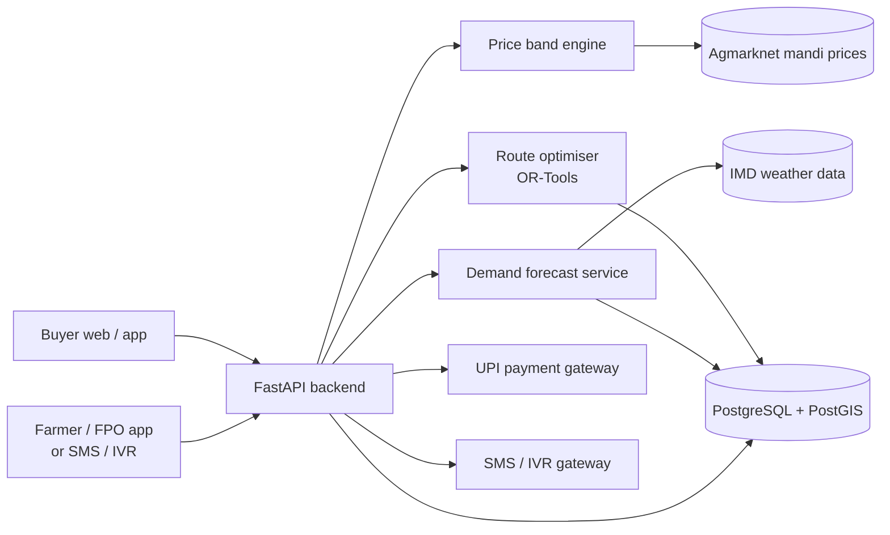
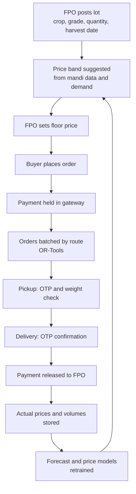

# Smart India Hackathon Workshop
# Date: 21 / 11 / 2026
## Reference Number: 26009606
## Name: Sastharjan P

## Problem Title
SIH 26033: Multiple intermediaries reduce farmers earnings and increase consumer prices.

## Problem Creater's Organization
Ministry of Consumer Affairs, Food & Public Distribution

## Theme
Agriculture, FoodTech & Rural Development

## Problem Description
Expected Solution: Create a digital marketplace that:

• Connects farmers/FPOs directly with consumers and bulk buyers.
• Provides logistics support.
• Uses AI for demand forecasting and route optimization.

Benefits:

• Better prices for farmers.
• Lower prices for consumers.
• Reduced supply chain inefficiencies.

## Proposed Solution :

**FarmDirect** lets farmers and Farmer Producer Organisations (FPOs) sell directly to households, retailers, canteens, institutions and processors. A plain marketplace only moves the listing online. FarmDirect also removes the reasons intermediaries exist in the first place: fragmented supply, unpredictable demand, and small, scattered loads that are expensive to move.

It does this through three linked components:

1. **FPO-first aggregation.** Individual farmers join an FPO, and the FPO lists produce as graded lots (crop, grade, quantity, harvest date, minimum price). One FPO lot can be large enough for a bulk buyer, which removes the need for a wholesaler to gather produce from many small farmers.
2. **Forecast-driven planning.** Demand forecasts per crop, per city and per week tell FPOs what to harvest and when to sell, and tell buyers what to stock. This reduces gluts (the main cause of distress sales) and shortages (the main cause of price spikes).
3. **Pooled logistics.** Orders from the same village cluster or urban zone are batched into shared routes, and route optimisation assigns them to trucks or partner transporters. Small orders become economical to deliver.

### How the solution works for each stakeholder

- **Farmer / FPO:** Registers an FPO or joins one, lists a lot, sees a fair price band suggested from public mandi data and live demand, sets a floor price, and receives payment after delivery is confirmed.
- **Consumer (household):** Orders fresh produce at a price closer to the farm gate, with delivery scheduled on the pooled route.
- **Bulk buyer (retailer, canteen, institution, processor):** Places recurring or one-off bulk orders against published FPO lots, with quality grading and traceable origin.
- **Transporter:** Receives optimised, batched routes with clear pickup and drop windows.
- **Government / FPO promoter:** Gets a dashboard of prices, volumes and forecast gaps by district, usable for planning and for monitoring the FPO scheme.

### How it addresses the problem

| Intermediary layer today | What FarmDirect does instead |
|---|---|
| Commission agents at mandis | FPO lots are listed directly; buyers order from the FPO |
| Wholesaler margin on fragmented supply | Bulk buyers purchase aggregated FPO lots at a published price band |
| Retailer markup | Households and small retailers order direct; delivery is pooled by route |
| Transport inefficiency on small loads | Route optimisation batches many small orders into one vehicle run |
| Gluts, distress sales, post-harvest loss | Demand forecast guides harvest and sale timing; price band shows when to sell |
| Opaque price formation | Price band is computed from public mandi data and visible to both sides |

### Innovation and uniqueness

- **Built around FPOs, not individual farmers.** Government support for about 10,000 FPOs already exists, so the platform starts with organised supply that can serve bulk buyers from the first transaction.
- **Transparent price band.** The suggested band is built from Agmarknet mandi prices and current order demand. Farmers see the same reference the buyer sees, which reduces the information gap that middlemen rely on.
- **Access for low-literacy users.** Voice-first interface in Tamil, Hindi and English, plus SMS and IVR for farmers without smartphones. Language translation uses Bhashini, the Government of India language platform.
- **Trust in payment.** The buyer pays at order, the amount is held, and it is released to the FPO only after OTP-confirmed pickup and delivery. This protects both sides from non-payment and non-delivery.
- **Closed feedback loop.** Actual prices, volumes and delivery outcomes feed back into the forecast and price-band models, so the system improves with each season.

## Technical Approach:
### 2.1 Technology stack

| Layer | Choice | Reason |
|---|---|---|
| Frontend | React progressive web app, with React Native for Android | One codebase for web and mobile; installable and works on low-end phones |
| Localisation | i18next with Bhashini translation | Tamil, Hindi, English and other regional languages |
| Backend API | Python FastAPI | Fast, well documented, and shares a language with the ML stack |
| Database | PostgreSQL with PostGIS | Relational data for orders and payments; geospatial queries for village clusters and routes |
| Price engine | Python (pandas, NumPy) | Median and percentile price bands from mandi data |
| Demand forecasting | LightGBM and Prophet, one model per crop and market cluster | Strong on small tabular datasets; Prophet handles seasonality explicitly |
| Route optimisation | Google OR-Tools (vehicle routing with capacity and time windows) | Open source, production proven |
| Messaging | SMS and IVR gateway (e.g., MSG91 or Twilio) | Reaches farmers without smartphones |
| Payments | UPI through a payment gateway with delayed settlement | Familiar to users; supports hold-until-delivery |
| Infrastructure | Docker containers on a cloud VM; GitHub Actions for CI | Reproducible deployment and simple maintenance |

### 2.2 System architecture

### 2.3 Methodology and order lifecycle

### 2.4 Core modules

**Module 1: FPO and farmer onboarding.** FPO registration with membership list, bank details and village cluster. Assisted onboarding by FPO staff for farmers who cannot self-register. Phone-based OTP login with consent recorded under the Digital Personal Data Protection Act, 2023.

**Module 2: Lot listing and price band engine.**
- Reference price = median of the modal prices for the same crop in the nearest mandis over the last 14 days (Agmarknet data).
- Demand adjustment = a multiplier based on current orders versus the forecast for the same week.
- Output = a suggested band [floor, ceiling]. The farmer sets the floor, and the floor cannot be lower than a cost-of-production estimate entered by the FPO.
- Quality tiers (Grade A, B, C) carry their own bands.

**Module 3: Demand forecasting.**
- Target: weekly demand per crop per city cluster.
- Features: lagged orders and prices, arrival volumes at mandis, day of week, festival calendar, rainfall and temperature.
- Models: LightGBM for the main forecast, Prophet as a seasonal baseline. The better model is chosen per crop on a held-out season.
- Evaluation: mean absolute percentage error (MAPE) on the most recent 8 weeks, reported for each crop.
- Use: sent to FPOs as a "sell this week or hold" signal and to buyers as an indicative availability calendar.

**Module 4: Order batching and route optimisation.**
- Orders are grouped by destination zone and pickup village cluster.
- OR-Tools solves a capacitated vehicle routing problem with time windows (pickup and delivery windows set by the FPO and buyer).
- Output: vehicle assignment, stop sequence and estimated delivery time.
- Objective: minimise total distance subject to vehicle capacity and time windows, so that small orders share a run.

**Module 5: Payments and settlement.** Buyer pays at order. Funds are held until both OTP confirmations are recorded (pickup and delivery). A dispute route allows the buyer to raise a quality claim before release, with photos and weight records attached.

**Module 6: Dashboards and analytics.** Price trends, volumes and forecast gaps by district, for FPOs, buyers and government users. Access is role-based.

### 2.5 Prototype scope for the demonstration

- FPO registration, lot listing with price band, and farmer sign-in by phone OTP.
- Buyer ordering with a payment-hold simulation (sandbox gateway).
- Forecast model trained on public Agmarknet data for at least five crops in Tamil Nadu markets, with MAPE reported on a holdout period.
- Route optimisation demonstrated on one district with at least 20 simulated orders.
- SMS notifications for order, pickup and delivery events.

## Feasibility and Viability :
### 3.1 Technical feasibility

- Every component is open source or available on a free tier.
- The main data source, Agmarknet mandi price data, is public and is also published on the Open Government Data platform (data.gov.in).
- The forecasting and routing problems are standard, well studied and within the reach of the team's skills.

### 3.2 Economic viability

- **Revenue model:** a commission on each completed transaction (set below the marketing margins documented in the research in Section 5), a delivery fee on pooled routes, and a subscription for bulk buyers and FPOs who want the analytics dashboard.
- **Why the margin pool is large:** RBI studies find that farmers receive about a third of the consumer rupee spent on vegetables and fruits. For example, the farmers' share is about 33% for tomato, 36% for onion, 37% for potato, 31% for banana, 35% for grapes and 43% for mango. Recovering even part of this margin for farmers, while still charging consumers less than retail, is what makes the model work.
- **Evidence that direct sale works:** an IIMA study of wholesale markets found that where farmers sold directly to consumers in Chennai's small market, the farmers' share was 85 to 95 percent for vegetables. A government study of Tamil Nadu's Uzhavar Sandhai and Andhra Pradesh's Rythu Bazaar found farmers got 15 to 40 percent more than wholesale prices while consumers paid 15 to 30 percent less than retail.
- **Break-even:** [Insert the calculation: number of orders per day per cluster needed to cover pickup, delivery and platform costs.]

### 3.3 Operational feasibility

- The government's Formation and Promotion of 10,000 FPOs scheme (approved February 2020, outlay of Rs 6,865 crore, running to 2027-28, with SFAC as nodal agency) has already produced a large base of FPOs that FarmDirect can onboard.
- E-NAM, launched by SFAC in April 2016, shows that a national digital trading platform for agriculture is workable. FarmDirect is designed to complement e-NAM for direct buyers rather than replace it.
- Pilot plan: start with two FPOs in one district and one urban buyer cluster, then extend after one full crop cycle.

### 3.4 Risks and strategies

| Risk | Strategy |
|---|---|
| Low digital literacy among farmers | Voice-first interface, SMS and IVR, and FPO staff doing assisted onboarding |
| Poor or no connectivity in villages | Offline-first PWA; orders sync when connection returns; SMS fallback |
| Perishability and quality disputes | Grading at listing, photos, weight check at pickup, quality-based price tiers, dispute window before payment release |
| Price manipulation or cartel behaviour | Price band built from public mandi data; anomaly alerts when prices move far from the reference |
| Non-payment or non-delivery | Payment held until OTP-confirmed pickup and delivery |
| High logistics cost on small loads | Pooling by route, minimum lot size, partner transporters, and delivery windows set in advance |
| Regulatory constraints (state APMC and marketing rules) | Engage state marketing boards early; use existing direct-marketing provisions, following the Uzhavar Sandhai model as precedent; legal review before launch |
| Data privacy | Consent recorded at sign-up, minimal personal data collected, compliance with the Digital Personal Data Protection Act, 2023 |
| Forecast error in a volatile season | Forecasts shown with uncertainty ranges; FPOs keep the floor price rule as a safety net |

## Impact and Benefits:
### 4.1 Target beneficiaries

- **Farmers and FPO members,** including women members of FPOs, who gain a larger share of the consumer rupee and steadier income.
- **Consumers,** who pay less than retail prices for fresh produce and get traceable origin information.
- **Bulk buyers and small retailers,** who get consistent supply and predictable prices.
- **Transporters and drivers,** who get planned, full-load routes instead of scattered trips.
- **State and central government,** who gain district-level price and supply data for planning and for monitoring the FPO scheme.

### 4.2 Expected benefits

| Dimension | Benefit |
|---|---|
| Economic (farmers) | Higher farm-gate price through direct sale; reduced distress selling through forecast-guided timing |
| Economic (consumers) | Lower end-price for fresh produce by removing layers of margin |
| Economic (logistics) | Lower cost per kilogram delivered through pooled routes |
| Social | Digital access for farmers with low literacy; income opportunities for women FPO members and local delivery partners |
| Environmental | Less post-harvest waste from gluts; fewer partly loaded vehicle trips |
| Governance | Transparent price and volume data by district for policy decisions |

### 4.3 Pilot success measures (proposed targets)

| Measure | Baseline | Pilot target |
|---|---|---|
| Farmer's share of consumer price | About one-third for vegetables and fruits (RBI) | [Set target after baseline survey; a direct-sale comparison is 60 to 90 percent in the IIMA study] |
| Price paid by consumer versus local retail | [Measure during pilot] | At least 10% lower |
| Post-harvest loss for participating FPOs | [Measure during pilot] | Reduction against baseline |
| Delivery cost per kg on pooled routes | [Measure during pilot] | Reduction against single-order delivery |
| Forecast accuracy (MAPE) | Naive weekly baseline | Lower MAPE than baseline on held-out weeks |

## Research and References:
1. Das, R., Roy, R., Gupta, S., Bordoloi, S., Kumar, R., Mohan, R., and Gulati, A. (2024). *Price Dynamics and Value Chain of Fruits in India: A Study of Grapes, Bananas and Mangoes.* RBI Working Paper Series No. 06/2024. Reserve Bank of India. Available at rbi.org.in.
2. Reserve Bank of India. *RBI Bulletin:* study of farmers' share in the consumer rupee for 16 major food items in the CPI-Combined basket. Available at rbi.org.in.
3. Reserve Bank of India studies on inflation in vegetables, pulses and fruits, reported in the press (Scroll.in), giving farmers' shares for tomato, onion, potato and other produce.
4. Indian Institute of Management Ahmedabad (2004). *Marketing of Fruits and Vegetables in India: A Study Covering the Ahmedabad, Chennai and Kolkata Markets.* IIMA Working Paper WP2004-06-09. Available via IDEAS/RePEc.
5. Government of India (2011), study on Uzhavar Sandhai and Rythu Bazaar, as cited in the RBI Bulletin on farmers' share in the consumer rupee.
6. Ministry of Agriculture and Farmers Welfare, Government of India. *Formation and Promotion of 10,000 Farmer Producer Organizations (FPOs)*, Cabinet approval, PIB Press Release, 19 February 2020 (PRID 1603629). Launched 29 February 2020.
7. Small Farmers' Agribusiness Consortium (SFAC). *e-National Agriculture Market (e-NAM)*, launched 14 April 2016. Available at enam.gov.in.
8. Agmarknet, Ministry of Agriculture and Farmers Welfare. Daily mandi prices. Available at agmarknet.gov.in.
9. Open Government Data Platform India. Available at data.gov.in.
10. Google OR-Tools, Vehicle Routing solver documentation. Available at developers.google.com/optimization.
11. Taylor, S. J., and Letham, B. (2018). "Forecasting at Scale." *The American Statistician*, 72(1).
12. Bhashini, Government of India language translation platform. Available at bhashini.gov.in.
13. Digital Personal Data Protection Act, 2023, Government of India.

*All figures in Section 3 and Section 4 are taken from the sources above. Pilot targets are proposals to be measured during the pilot.*

